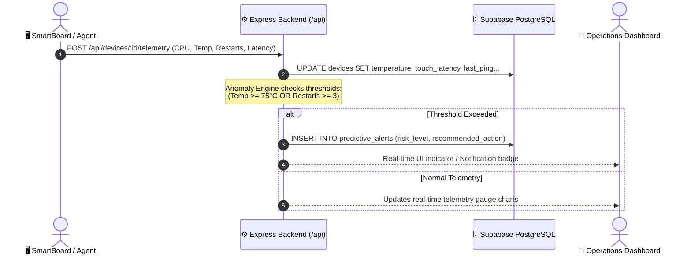
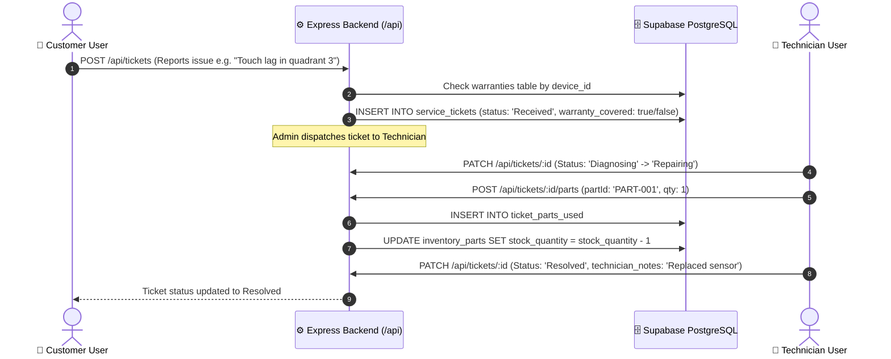
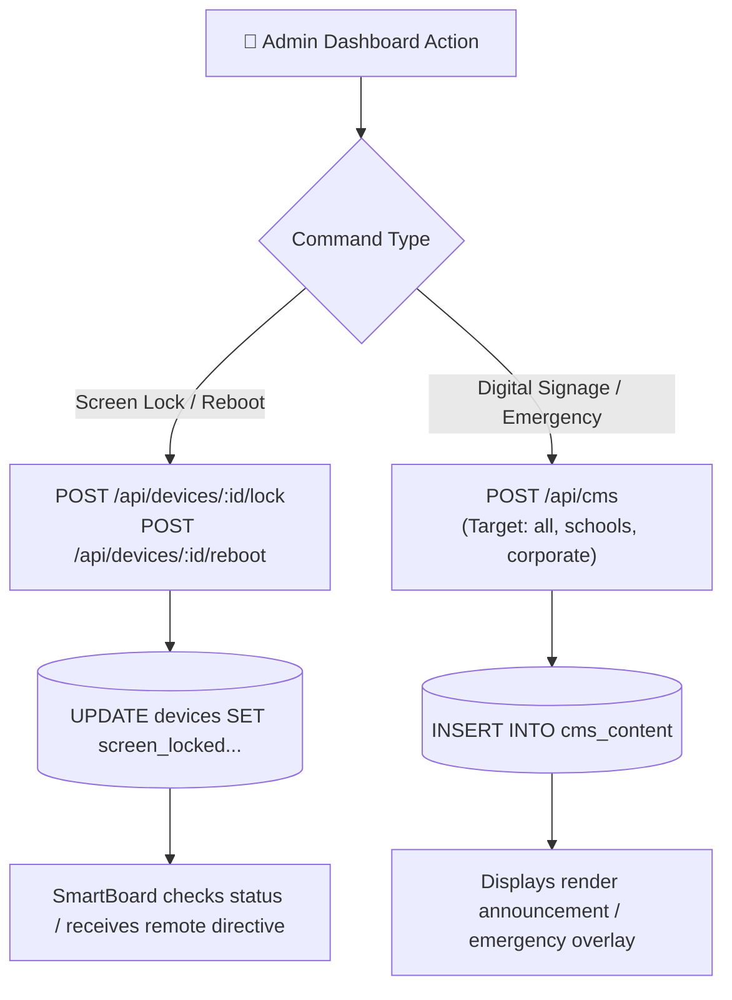
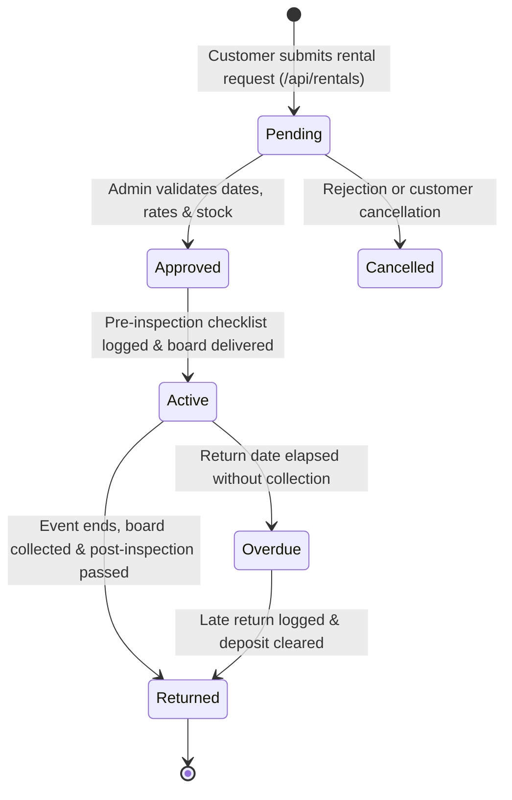

# 🌟 Millennium SmartBoard Management System
## System Architecture, Functionality & Data Flow Documentation

---

## 1. Executive Summary

The **Millennium SmartBoard Management System** is an enterprise IoT fleet management and service platform designed for **Brains Infinite Innovations Inc.**. It connects, monitors, and services the fleet of **Millennium Interactive SmartBoards** (65", 75", and 86" 4K interactive displays with dual Android 13 and Windows 11 Pro OPS modules) deployed across schools and corporate institutions across the Philippines.

The platform provides a single glass pane for:
1. **Real-time IoT Telemetry & Remote Control**: Monitoring live hardware vitals (CPU, RAM, storage, temperature, touch latency, uptime) and issuing remote commands (lock screen, reboot, power schedules).
2. **Predictive Maintenance**: Detecting anomalous patterns (e.g., thermal spikes or unexpected reboot loops) before physical hardware breakdown occurs.
3. **End-to-End Service Ticketing**: A Kanban-style repair workflow that matches tickets with warranty status and automatically deducts spare parts from live inventory.
4. **Isolated Dual-Channel Messaging**: Segregated communication channels on each ticket (internal staff discussion vs. customer-facing support).
5. **Short-Term Device Rental & Scheduling**: Booking management, pricing calculation, deposit tracking, and pre-/post-rental physical inspection checklists.

---

## 2. User Roles & Permission Matrix

The application enforces Role-Based Access Control (RBAC):

| Feature / Scope | 👑 Administrator (`admin`) | 🔧 Field Technician (`technician`) | 🏫 Customer (`customer`) |
| :--- | :---: | :---: | :---: |
| **Fleet Visibility** | All registered devices across all cities | Assigned devices / service areas | Only devices owned by their organization |
| **Remote Commands** | Reboot, lock/unlock, wallpaper, power schedule | Limited / diagnostic actions | View power status only |
| **Service Tickets** | Create, assign technicians, approve parts, close | Diagnose, update status, log parts used | Submit new tickets, track progress, review |
| **Ticket Communication**| Access both Staff Chat & Customer Chat | Access Staff Chat (Admin ↔ Tech) | Access Customer Chat (Customer ↔ Admin) |
| **Spare Parts Inventory**| View, add new parts, edit restock thresholds | View inventory, select parts used in repairs | Hidden |
| **Rentals Management** | Approve/reject bookings, log return checklists | View delivery/pickup schedules | Submit booking requests, view contract status |
| **Digital Signage (CMS)**| Create and broadcast announcements/media | View active announcements | View announcements sent to their boards |
| **Predictive Alerts** | Full alert dashboard & risk prioritization | View alerts on assigned hardware | Hidden |

---

## 3. Core Functional Modules

### 3.1 Device Fleet Management & IoT Telemetry
- **Hardware Telemetry**: Collects CPU load, RAM usage, storage percentage, internal temperature (°C), touch latency (ms), and network packet loss.
- **Remote Operations**: Administrators can toggle screen locks, restart displays, push new custom wallpapers, and configure automated power ON/OFF schedules.
- **SmartBoard Simulator**: An embedded interactive 4K display simulator allows operations teams to test board behaviors virtually.

### 3.2 Service Desk & Repair Lifecycle
- **Lifecycle Stages**:
  $$\text{Received} \longrightarrow \text{Diagnosing} \longrightarrow \text{Repairing} \longrightarrow \text{Resolved} \longrightarrow \text{Closed}$$
- **Warranty Integration**: Automatically looks up device purchase date and serial number to verify whether repairs and parts are covered under warranty.
- **Parts Consumption**: When a technician marks parts used (e.g., *Touch Controller V2*, *105W Power Supply*), the quantity is subtracted from the central inventory table in the same transaction.

### 3.3 Predictive Maintenance Engine
- Evaluates incoming device telemetry against defined risk thresholds:
  - **High Risk**: Internal temperature $\ge 75^\circ\text{C}$ OR unexpected restarts $> 5$ in 7 days.
  - **Moderate Risk**: Temperature $65^\circ\text{C} - 74^\circ\text{C}$ OR touch latency $> 15\text{ms}$.
  - **Low Risk**: Standard operating ranges.
- Automatically generates entries in the `predictive_alerts` table recommending preventive actions (e.g., fan cleaning, power supply inspection) prior to hardware failure.

### 3.4 Rental & Event Scheduling
- Handles short-term smartboard rentals for conventions, seminars, and corporate meetings.
- Manages rental status: `Pending` $\rightarrow$ `Approved` $\rightarrow$ `Active` $\rightarrow$ `Returned` (or `Overdue`).
- Stores pre-rental and post-rental physical condition checklists in JSON format to guarantee asset integrity and verify security deposits.

### 3.5 Content Management & Digital Signage (CMS)
- Enables remote broadcasting of announcements, images, videos, or emergency broadcast banners.
- Granular targeting: Broadcast to **All Displays**, **Schools Only**, **Corporate Only**, or a **Specific Board ID**.

---

## 4. System Data Flows

### Flow 1: Device Telemetry & Anomaly Detection



---

### Flow 2: Service Ticket & Automated Inventory Deduction



---

### Flow 3: Remote Device Control & Signage Dispatch



---

### Flow 4: Rental Booking & Inspection Cycle



---

## 5. Technical Architecture & Stack

```
┌────────────────────────────────────────────────────────────────────────┐
│                              FRONTEND                                  │
│  - public/landing.html  : Public portal, product tour, marketing showcase│
│  - public/index.html    : Authenticated multi-role single-page app      │
│  - public/js/app.js     : Reactive state management, DOM rendering     │
│  - public/css/          : Custom responsive stylesheet & dark theme    │
└───────────────────────────────────┬────────────────────────────────────┘
                                    │ HTTPS / REST (Bearer Token + JSON)
┌───────────────────────────────────▼────────────────────────────────────┐
│                              BACKEND                                   │
│  - Runtime              : Node.js with TypeScript (tsx execution)      │
│  - Web Framework        : Express 5 (src/server.ts)                    │
│  - Routing & Logic      : src/routes/api.ts                            │
│  - Authentication       : Bearer Token verification + Passport.js      │
│                           (Google, Apple, Facebook OAuth, Local Hash)  │
│  - Email Dispatcher     : Nodemailer / Brevo API for password reset    │
└───────────────────────────────────┬────────────────────────────────────┘
                                    │ pg Pool (keepAlive + transient retry)
┌───────────────────────────────────▼────────────────────────────────────┐
│                              DATABASE                                  │
│  - Database Engine      : Supabase PostgreSQL (Cloud Hosted)           │
│  - Data Access Layer    : src/db/database-supabase.ts                  │
│  - Resilience           : Auto-retry backoff against pooler timeouts   │
│  - Key Tables           : users, customers, devices, warranties,       │
│                           service_tickets, ticket_parts_used,          │
│                           ticket_messages, inventory_parts, rentals,   │
│                           cms_content, predictive_alerts, audit_logs   │
└────────────────────────────────────────────────────────────────────────┘
```

---

## 6. Key Database Tables

| Table Name | Description | Key Relationships |
| :--- | :--- | :--- |
| `users` | User accounts, roles, location scopes, OAuth metadata | `role IN ('admin', 'technician', 'customer')` |
| `customers` | Client institutions (Schools and Corporate) | Linked to `users.customer_id` |
| `devices` | Physical smartboards, telemetry, network IP, power status | Foreign key: `customer_id -> customers(id)` |
| `warranties` | Warranty terms, coverage types, expiration dates | Foreign key: `device_id -> devices(id)` |
| `service_tickets`| Repair tickets, priority, lifecycle status | Foreign keys to `devices`, `customers`, `users` |
| `ticket_parts_used`| Log of spare parts installed on a specific ticket | Foreign key: `ticket_id -> service_tickets(id)` |
| `ticket_messages`| Messages tagged as `staff` or `customer` channel | Foreign key: `ticket_id -> service_tickets(id)` |
| `inventory_parts`| Spare components in stock, cost, low-stock threshold | Referenced by `ticket_parts_used` |
| `rentals` | Short-term equipment bookings, deposits, inspections | Foreign key: `customer_id -> customers(id)` |
| `cms_content` | Digital signage broadcasts and scheduled alerts | Targeted by audience or specific device |
| `predictive_alerts`| Automated warnings generated by the telemetry monitor | Foreign key: `device_id -> devices(id)` |
| `audit_logs` | Security and administrative audit trail | Records user action and timestamps |

---

## 7. Primary API Endpoints

### Authentication & Account
- `POST /api/auth/login` - Authenticate user credentials and return signed Bearer token.
- `POST /api/auth/forgot-password` - Request a password reset code via email.
- `POST /api/auth/reset-password` - Update password using validated reset code.

### Device Fleet
- `GET /api/devices` - Fetch smartboards (filtered automatically by requester scope).
- `POST /api/devices` - Register a new smartboard with assigned customer.
- `POST /api/devices/:id/telemetry` - Ingest device vitals (CPU, temperature, latency).
- `POST /api/devices/:id/lock` - Toggle remote screen lock.
- `POST /api/devices/:id/reboot` - Issue remote reboot directive.

### Service & Maintenance
- `GET /api/tickets` - Retrieve service tickets.
- `POST /api/tickets` - File a new service ticket.
- `PATCH /api/tickets/:id` - Advance ticket status and update notes.
- `GET /api/tickets/:id/messages` - Fetch channel messages (`staff` or `customer`).
- `POST /api/tickets/:id/messages` - Send a message into the specified channel.
- `POST /api/tickets/:id/parts` - Deduct spare part and attach to ticket.

### Inventory, Rentals & CMS
- `GET /api/inventory` & `POST /api/inventory` - Inventory parts management.
- `GET /api/rentals` & `POST /api/rentals` - Rental booking creation and status workflow.
- `GET /api/cms` & `POST /api/cms` - Publish or manage signage broadcasts.
- `GET /api/alerts` - Query predictive maintenance alerts.
